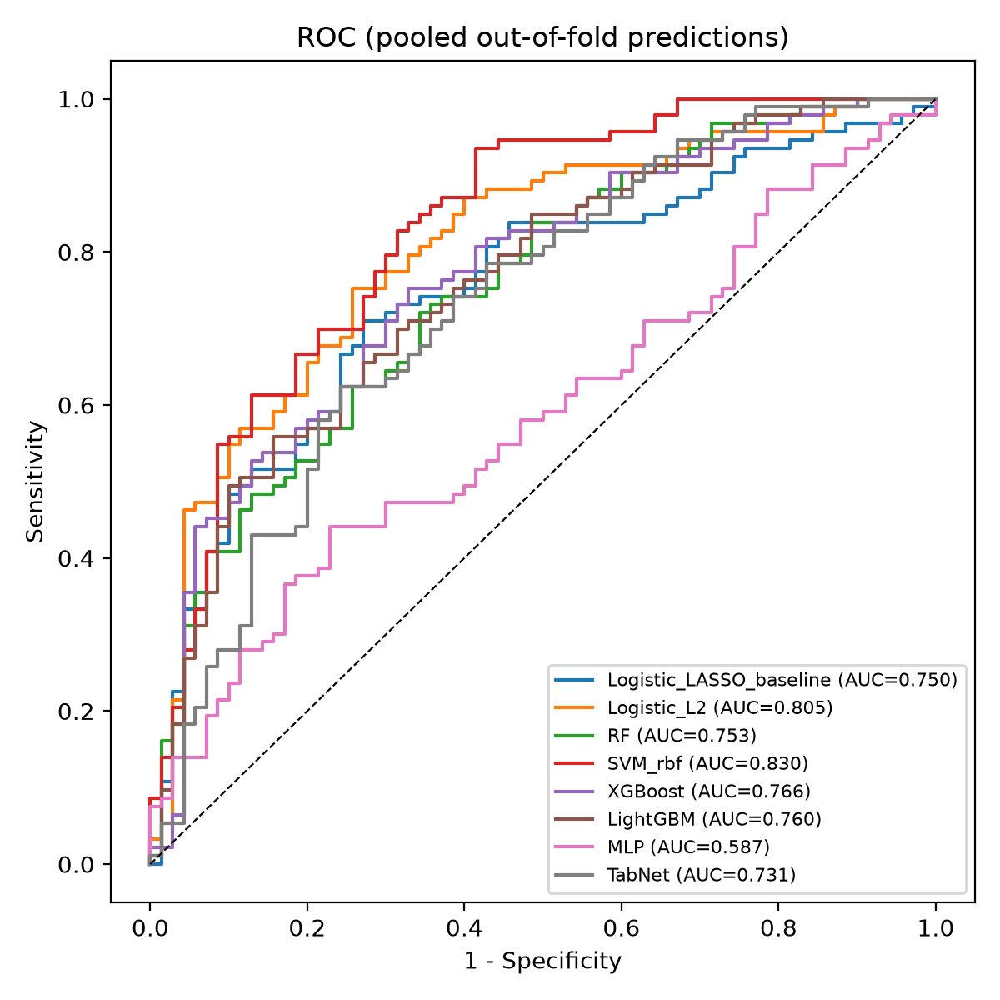
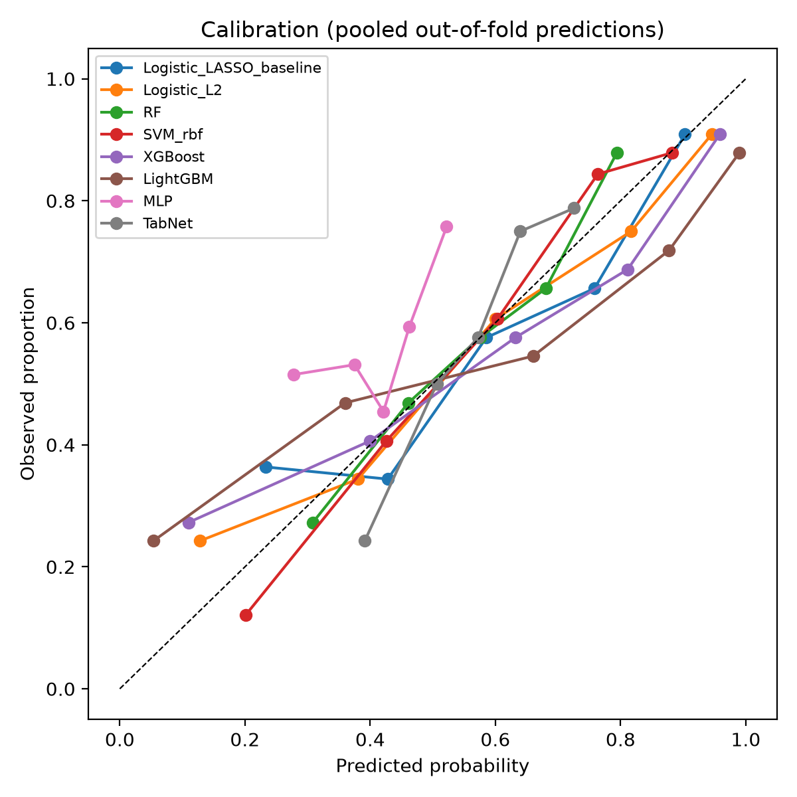
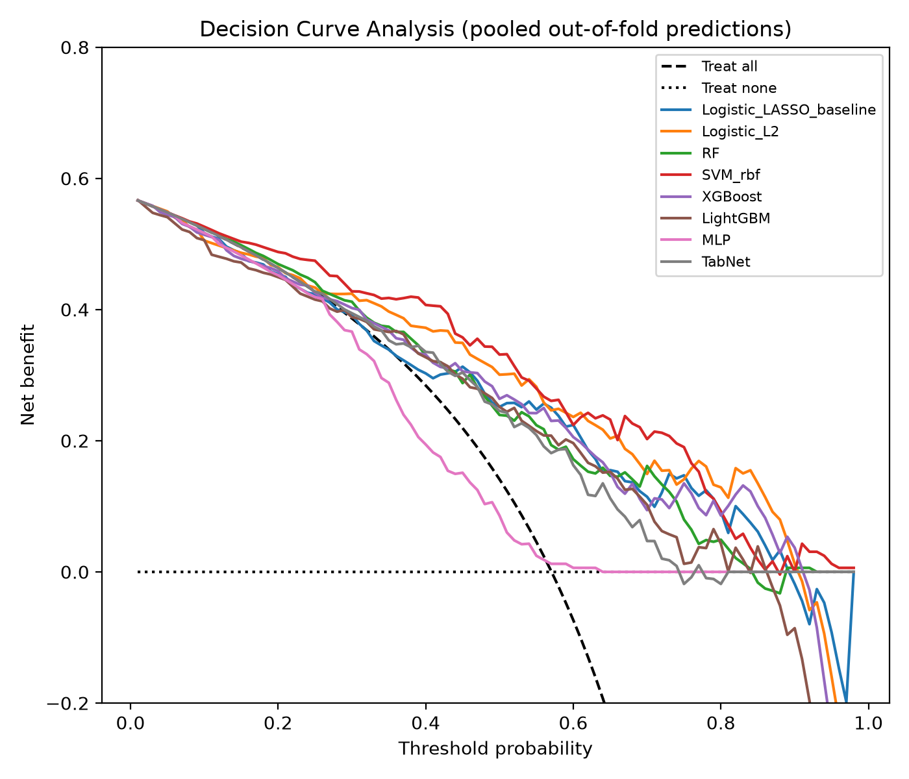
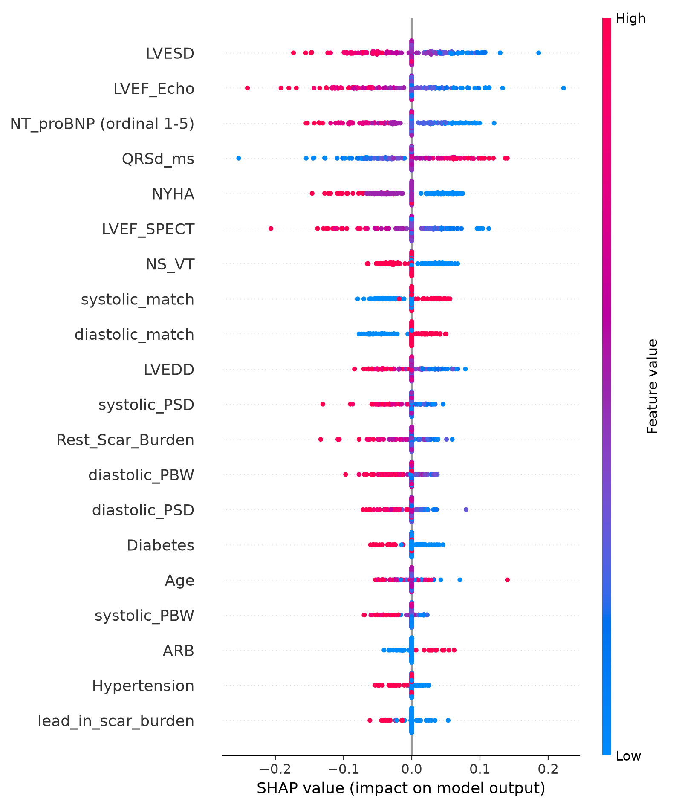
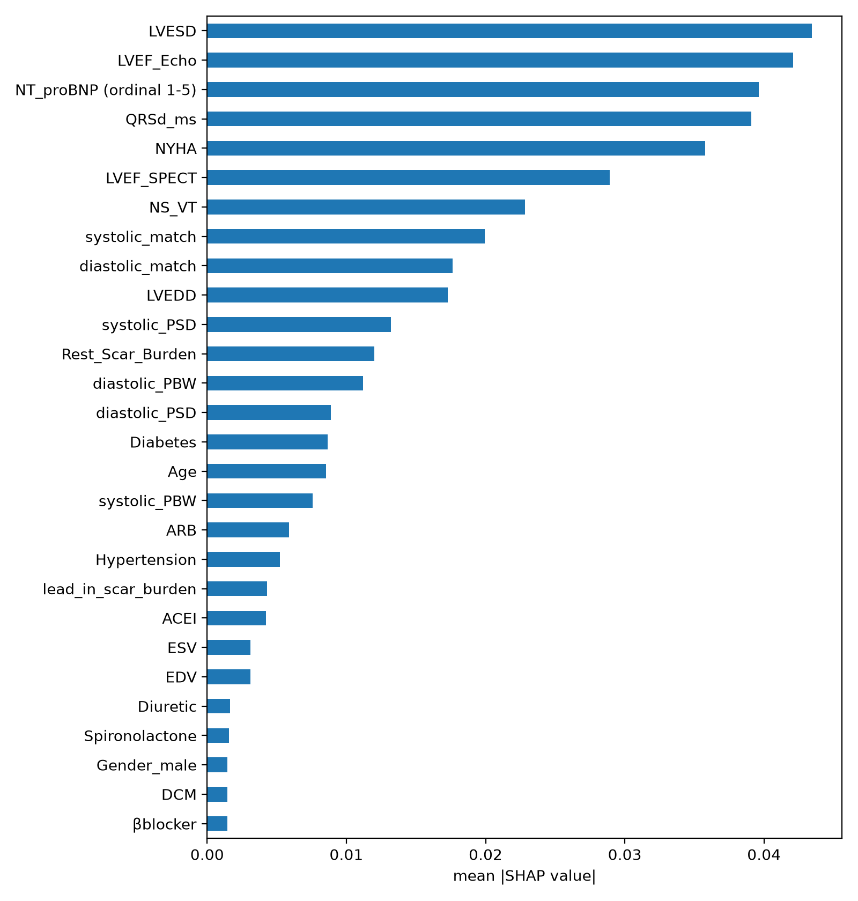

# CRT 应答预测：传统基线 vs AI 模型对比报告

## 设计

- 交叉验证方案：外层 5 折 × 5 次重复分层 CV，内层 3 折网格调参（嵌套，无数据泄漏）
- 队列：163 例 CRT 患者（应答 93 例，应答率 57.1%）
- 随机种子：2025（所有模型与 CV 分割统一）
- 设备：cuda（TabNet 使用 GPU 加速）

## 最优模型：**SVM_rbf**（SHAP 方法：KernelExplainer）

## 模型汇总（外层折 AUC，mean±sd）

| model                   |   mean_auc |   sd_auc |   min_auc |   max_auc |
|:------------------------|-----------:|---------:|----------:|----------:|
| SVM_rbf                 |      0.820 |    0.060 |     0.684 |     0.932 |
| Logistic_L2             |      0.793 |    0.054 |     0.688 |     0.877 |
| XGBoost                 |      0.757 |    0.061 |     0.654 |     0.850 |
| Logistic_LASSO_baseline |      0.746 |    0.074 |     0.568 |     0.906 |
| LightGBM                |      0.745 |    0.075 |     0.553 |     0.893 |
| RF                      |      0.742 |    0.036 |     0.648 |     0.795 |
| TabNet                  |      0.652 |    0.101 |     0.406 |     0.786 |
| MLP                     |      0.559 |    0.100 |     0.353 |     0.722 |

## 与 LASSO 基线的配对比较

同一折配对 Wilcoxon 符号秩检验 + Holm 多重比较校正（比较单位：每个外层折的 AUC）：

| model       |   mean_auc_diff |   p_wilcoxon |   p_holm |
|:------------|----------------:|-------------:|---------:|
| SVM_rbf     |          0.0747 |       0.0000 |   0.0000 |
| Logistic_L2 |          0.0478 |       0.0045 |   0.0181 |
| XGBoost     |          0.0114 |       0.3892 |   1.0000 |
| LightGBM    |         -0.0003 |       0.7879 |   1.0000 |
| RF          |         -0.0034 |       0.9893 |   1.0000 |
| TabNet      |         -0.0937 |       0.0001 |   0.0005 |
| MLP         |         -0.1864 |       0.0000 |   0.0000 |

## 图形

- 
- 
- 
- 
- 

## 数据质量备注

- Age=165 at row 33 outside plausible range [18, 120] (suspected entry error; kept as-is to match the published cohort)

## 最优模型 SHAP 特征重要性（前 10）

|                                                                     |   mean_abs_shap |
|:--------------------------------------------------------------------|----------------:|
| LVESD                                                               |          0.0434 |
| LVEF_Echo                                                           |          0.0421 |
| NT_proBNP(<1000=1; 1000~2499=2; 2500~4999=3; 5000~1000=4; >10000=5) |          0.0396 |
| QRSd_ms                                                             |          0.0391 |
| NYHA                                                                |          0.0358 |
| LVEF_SPECT                                                          |          0.0289 |
| NS_VT                                                               |          0.0228 |
| systolic_match                                                      |          0.0200 |
| diastolic_match                                                     |          0.0176 |
| LVEDD                                                               |          0.0173 |

## 方法说明（供论文 Methods 复用）

All models were embedded in leak-free preprocessing pipelines and evaluated with nested repeated stratified cross-validation (outer 5-fold × 5 repeats; inner 3-fold grid search optimizing AUC). Discrimination (AUC), calibration (Brier score, calibration slope), decision-curve net benefit, and Youden sensitivity/specificity were computed per outer fold on out-of-fold predictions. Pairwise differences versus the LASSO baseline (univariate selection + L1-penalized logistic regression, replicating the published nomogram method) were tested with Wilcoxon signed-rank tests and Holm correction. SHAP values were computed for the best-performing model on the full cohort for interpretation.